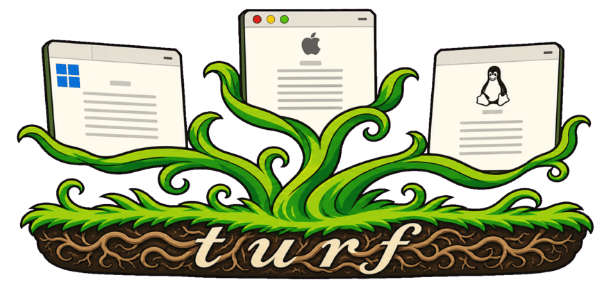

<!-- SPDX-License-Identifier: MPL-2.0 -->
<!-- Copyright (c) 2025-2026 awesomo4000 -->

<p align="left">
  
</p>

# turf

Lightweight webviews with message passing between native code (Zig) and JavaScript. Turf creates native windows with platform webviews for building portable desktop applications using web technologies.

## Features

- Native window management with platform webview integration
- Bidirectional JSON message passing between JavaScript and Zig
- URL, local file, and HTML content loading
- JavaScript evaluation from native code
- Persistent zoom controls and standard application quit behavior on macOS

## Supported OSes

| Operating system | Native window layer | Web technology | Requirements |
| --- | --- | --- | --- |
| macOS | Cocoa | WebKit (`WKWebView`) | Xcode Command Line Tools |
| Linux | GTK4 | WebKitGTK 6.0 and JavaScriptCoreGTK 6.0 | GTK4 and WebKitGTK development packages |
| Windows | Win32 | Microsoft Edge WebView2 | WebView2 Runtime |

### Prerequisites

- Zig 0.17.0
- The platform requirements listed above

### Building

```bash
# Build the project
zig build

# Run the application
zig build run

# Run the messaging demo
zig build run-demo

# Run tests
zig build test
```

To cross-build Intel macOS from Apple Silicon, pass a compatible SDK explicitly:

```bash
zig build -Dtarget=x86_64-macos -Dmacos-sdk=/Library/Developer/CommandLineTools/SDKs/MacOSX26.sdk
```

Windows cross-build targets are `x86_64-windows`, `aarch64-windows`, and
`x86-windows`. Linux builds need target-compatible GTK4 and WebKitGTK 6 development
libraries; macOS Homebrew libraries cannot satisfy those dependencies.

Linux uses explicit public C ABI declarations to avoid Zig 0.16 GTK header
translation failures. Check these declarations against the installed development
headers with `python3 tests/linux_abi.py`; this requires `cc` and `pkg-config`.

### Usage

```bash
# Show usage
./zig-out/bin/turf --help

# Launch with default page
./zig-out/bin/turf

# Open a URL
./zig-out/bin/turf https://example.com

# Open a local file
./zig-out/bin/turf path/to/file.html
```

### Startup logo API

Set `WindowConfig.startup_logo` when creating a window:

```zig
const config: turf.WindowConfig = .{
    .geometry = .{ .x = 100, .y = 100, .width = 600, .height = 800 },
    .title = "My app",
    .startup_logo = .in_out,
};
```

- `.off` is the default and hides the bottom-right Turf logo.
- `.in_out` plays the rainbow animation, returns to gray, then fades out and removes the logo.
- `.stay` plays the rainbow animation and leaves the gray logo visible.

The setting applies whenever a page loads in the window. It is available only through the Zig API.

### Automation

Automation is opt-in on macOS, Linux, and Windows. It uses an explicit Unix socket
path on macOS/Linux or a local named pipe on Windows, with the same JSON-RPC commands.
There is no discovery or hibrow integration yet. On macOS/Linux, create a private
directory, then launch Turf:

```bash
automation_dir=$(mktemp -d /tmp/turf-automation.XXXXXX)
echo "$automation_dir/control.sock"
./zig-out/bin/turf --automation-socket "$automation_dir/control.sock"
```

From another terminal, use the actual socket path printed by
`echo "$automation_dir/control.sock"` in the first shell:

```bash
python3 tools/turf-client.py /tmp/turf-automation.XXXXXX/control.sock info
python3 tools/turf-client.py /tmp/turf-automation.XXXXXX/control.sock evaluate '{"expression":"document.title"}'
python3 tools/turf-client.py /tmp/turf-automation.XXXXXX/control.sock navigate '{"url":"https://example.com"}'
python3 tools/turf-client.py /tmp/turf-automation.XXXXXX/control.sock resize '{"width":800,"height":600}'
python3 tools/turf-client.py /tmp/turf-automation.XXXXXX/control.sock screenshot -o /tmp/turf.png
python3 tools/turf-client.py /tmp/turf-automation.XXXXXX/control.sock close
```

On Windows, use a unique local pipe name in two terminals:

```powershell
.\zig-out\bin\turf.exe --no-focus --automation-socket '\\.\pipe\turf-dev'
python tools\turf-client.py '\\.\pipe\turf-dev' info
python tools\turf-client.py '\\.\pipe\turf-dev' screenshot -o turf.png
python tools\turf-client.py '\\.\pipe\turf-dev' close
```

Windows pipes have an ACL restricted to the current user, reject remote clients,
and refuse to replace an existing pipe name. Pipe names use the `\\.\pipe\` prefix
followed by a printable ASCII name without slashes or spaces. They disappear when
the process exits. The Python client uses Windows overlapped I/O with a deadline;
no extra Python packages are needed for Turf's protocol.

Embedding applications enable the same endpoint on the main thread after creating
the window and before entering its event loop:

```zig
window.createWindow();
try window.startAutomation("/absolute/private-directory/control.sock");
// For background automation instead:
// try window.startAutomationWithOptions("/absolute/private-directory/control.sock", .{ .background = true });
try window.run();
// window.deinit() stops automation; window.stopAutomation() can stop it earlier.
```

For Unix sockets, the parent directory must already exist, belong to the current user, and have no
group or other permissions, typically mode `0700`. Turf creates a `0600` socket
and accepts connections only from the same user. Existing paths are never
replaced. Normal shutdown removes the socket; after a crash, use a new path or
remove the stale socket yourself. Automation controls this application, including
executing page JavaScript and closing its window. Keep it disabled when unused.
No private WebKit APIs are required. macOS does not require SIP changes.

The macOS bridge now includes `automation.m` alongside `cocoa_bridge.m`; embedding
builds that compile the bridge themselves must compile both with ARC and link
Cocoa and WebKit. Linux builds compile `src/platforms/linux/automation.c` and
link GTK4, WebKitGTK 6, JavaScriptCoreGTK 6, and X11. The bundled library,
executable, and demo builds already include the Linux bridge. Foreground native
input also needs the XTest extension and `libXtst.so.6` at runtime.
Windows builds include `automation.zig` and `automation_transport.c`, linking
Win32 security and window APIs. The Windows backend calls WebView2's public
in-process DevTools API; it does not open a CDP debugging port.

#### Socket protocol, version 1

Each request and response is one UTF-8 JSON line using JSON-RPC 2.0. Requests need
a string or numeric `id`, a string `method`, and an optional object `params`.
Notifications and batches are not supported. Unknown methods return `-32601`.

```json
{"jsonrpc":"2.0","id":1,"method":"evaluate","params":{"expression":"document.title"}}
{"jsonrpc":"2.0","id":1,"result":{"type":"string","value":"Welcome"}}
```

| Method | Parameters | Result |
| --- | --- | --- |
| `info` | None | Protocol version, PID, engine, page title, URL, loading state, methods, capabilities, and viewport dimensions |
| `evaluate` | `expression` string | `{type, value}` after awaiting promises; `undefined` omits `value` |
| `navigate` | Absolute `url`, using http, https, file, or about | Final URL after navigation finishes; failure returns an error |
| `screenshot` | None | Viewport PNG as base64 `data`, plus `format`, pixel `width`, and pixel `height` |
| `resize` | Numeric `width` and `height`, 1–8192 | Webview dimensions in points after resizing the window content |
| `click` | `x`, `y` in webview points from the top-left; optional `modifiers` | Dispatches a native left click |
| `key` | `key`; optional `modifiers` and boolean `repeat` | Dispatches native key-down and key-up events |
| `typeText` | `text` | Inserts Unicode text through the native text-input interface |
| `close` | None | `{closing: true}`, followed by closing the window |

Evaluation runs in the main frame and page world. On macOS it requires macOS 11 or newer.
Values use JavaScript JSON serialization: cycles and BigInts produce errors;
non-finite numbers become null, and function/undefined object properties are
omitted. Object handles, cross-origin frame selection, and debugger
breakpoints are not part of this protocol.

Commands execute sequentially on each connection. macOS serves one active client
at a time; Linux accepts up to 16 clients and Windows up to 8, so a pending evaluation
does not block another client. Clients may reuse a connection or reconnect for each request. An incomplete or
idle request has a 10-second read deadline. Operations and response writes have
30-second deadlines. A timed-out JavaScript operation may still finish; its late
result is discarded. Requests are limited to 1 MiB and responses to 32 MiB.
A navigation response means the page finished loading, not that application
fetches, fonts, or rendering have settled; use evaluation to wait for app readiness.
Linux and Windows reject overlapping navigation with `-32000`; wait for `info.loading`
to be false before navigating again. They reject embedded NULs in string parameters
and numeric IDs outside the JavaScript safe-integer range; use string IDs for larger values.
On Windows, requests arriving before WebView2 initializes return `-32000`; retry `info`.

#### Grab binary data

The Python client implements `grab` through chunked `evaluate` calls. `grab` is
not a socket method. The source may be an HTTP(S), blob, or data URL, or JavaScript
that returns a URL, base64 string, data URI, Blob, ArrayBuffer, or typed array.
Promises are awaited. Browser origin and content-security rules still apply.

```bash
python3 tools/turf-client.py /path/to/control.sock grab \
  '{"source":"document.querySelector(\"img\").currentSrc"}' -o /tmp/otter.jpg
python3 tools/turf-client.py /path/to/control.sock grab \
  '{"source":"document.querySelector(\"canvas\").toDataURL()"}' -o /tmp/canvas.png
```

Data stays in a temporary page object and is read in 256 KiB binary chunks, each
encoded separately as base64. The client writes chunks to a temporary file next
to the destination and replaces the destination only after the transfer succeeds.
It cleans up the page object on success and failure; abandoned objects expire
after two minutes of inactivity. Navigation destroys the transfer state and
causes an error. This bounds response and client-buffer sizes, but the complete
Blob still occupies memory in the webview. Keep `grab.js` beside `turf-client.py`
when copying the client elsewhere.

#### Native input

On macOS, `click` and `key` deliver AppKit events to the target view and window's
responder chain. Linux uses XTest through Turf's socket API, activates the target
window, and delivers real X11 input. Clicks move the desktop pointer
to the target and leave it there. This uses the desktop input stream, so concurrent user input
can interfere. By default, startup, clicks, and key events activate Turf.
Use `--no-focus` to show the window without activating it, with or without an
automation socket. For example:

```bash
./zig-out/bin/turf --no-focus --automation-socket /path/to/control.sock
./zig-out/bin/turf --no-focus https://example.com
```

Embedders can set `WindowConfig.no_focus = true` for both startup and automation,
or pass `.{ .background = true }` to `startAutomationWithOptions` before `run()`
for background automation only. `startAutomation` keeps the default foreground
behavior unless the window has `no_focus` enabled. `info.background` reports the
effective automation mode. These options support macOS, Linux, and Windows.

On macOS, no-focus startup brings the window forward without activating the
application. It does not disable WebKit's visibility-based throttling: fully
covering or minimizing the window can still suspend animation frames.

Windows input uses WebView2's in-process `Input` methods and reports
`nativeInput: "webview2-devtools"`. Events are trusted browser input, rather than
synthetic DOM events or system-wide `SendInput` calls. Background click, key, and
text input are supported without moving the desktop pointer or activating Turf.
This tests page interaction; it does not test native dialogs or physical OS input routing.

On Linux, background `click` and `key` return `-32004` without activating the
window. Background evaluation, navigation, resizing, screenshots, `grab`, and
`typeText` remain available. `info.capabilities.nativeInput` is `x11-xtest` when
available, otherwise `unsupported`; `backgroundNativeInput` and `keyRepeat` are
false. Wayland native click/key injection is not implemented. Linux tests cover
the X11 backend; Wayland core operations have not been verified yet.

Input does not call DOM `.click()` or construct JavaScript keyboard events.
The window remains visible; this is not headless mode.
Native dialogs and other operations requiring foreground interaction are not
covered by the background input checks. macOS input is application-local and
does not need Accessibility permission. No backend emulates an IME.
A response acknowledges dispatch, not the
completion of JavaScript event handlers. Poll the relevant page state afterward.

```bash
python3 tools/turf-client.py /path/to/control.sock click '{"x":100,"y":120}'
python3 tools/turf-client.py /path/to/control.sock key '{"key":"ArrowDown"}'
python3 tools/turf-client.py /path/to/control.sock key '{"key":"ArrowRight","modifiers":["shift"]}'
python3 tools/turf-client.py /path/to/control.sock key '{"key":"a","modifiers":["meta"]}'
python3 tools/turf-client.py /path/to/control.sock typeText '{"text":"Hello, otter 🦦"}'
```

Modifiers are `shift`, `control`, `alt`, and `meta`, which map to macOS Shift,
Control, Option, and Command, or Linux Shift, Control, Alt, and Super. Use Control+A
for select-all on Linux. Supported keys are printable US-layout ASCII,
`ArrowLeft`, `ArrowRight`, `ArrowUp`, `ArrowDown`, `Home`, `End`, `PageUp`,
`PageDown`, `Delete`, `Backspace`, `Enter`, `Tab`, `Escape`, and `Space`.
On macOS and Windows, `repeat: true` marks the key-down as a repeat; it does not hold the key
down. Linux returns `-32004` for synthetic repeat and uses the current X keyboard
map for printable keys. Use `typeText` for Unicode strings. macOS inserts through
the native text client; Linux uses WebKit's `InsertText` editing command. Both
require a focused editable field and avoid generating a key event per character.
Turf provides standard Edit menu actions on macOS.

Click coordinates are viewport points, not screenshot pixels. Retina screenshots
can have twice as many pixels per axis. When deriving coordinates from DOM client
rectangles, account for the ratio between `info.viewport` dimensions and
`window.innerWidth` / `window.innerHeight`, and scroll the element into view first.
Only a single left click is currently supported; drag, right-click, and held-key
sequences are not implemented.

Run the Linux suite in an X11 session with `DISPLAY` and `XAUTHORITY` set:

```bash
python3 tests/automation_linux.py
```

All commands, including native input, go through Turf's socket. `wmctrl` and
`xprop` only observe window/focus state. The suite checks background operations
without focus activation, then foreground native input, protocol limits,
concurrent clients, screenshots, and chunked transfers. Foreground tests bring
Turf forward; no desktop automation helper is required by the server itself.

For an isolated virtual desktop, install the test dependencies and run:

```bash
sudo apt-get install xvfb xauth dbus
python3 tests/automation_xvfb.py
```

The runner starts a private Xvfb display with TCP disabled and a private
D-Bus session. It runs the socket and lifecycle checks, including foreground native input,
without moving your physical desktop pointer or changing its focus. It uses
software rendering and cleans up the virtual display afterward. An optional
first argument selects a different Turf executable. Window-manager focus checks
remain in `automation_linux.py`, which runs on a regular desktop.

#### Windows testing

Run the native Turf protocol tests from a Windows desktop session, with no
Playwright dependency and no debugging port:

```powershell
python tests\automation_windows_protocol.py zig-out\bin\turf.exe
```

The suite covers foreground/background input, focus preservation, navigation,
screenshots, chunked grabs, request limits, concurrent clients, timeout recovery,
and shutdown. An additional WebView2 CDP smoke test uses Playwright:

```powershell
python -m venv .venv
.venv\Scripts\python -m pip install playwright
.venv\Scripts\python tests\automation_windows.py zig-out\bin\turf.exe
.venv\Scripts\python tests\automation_windows.py zig-out\bin\demo.exe --bridge
```

The smoke test enables a temporary CDP port, uses a fresh WebView2 profile, checks
DOM access, trusted clicks, text entry, and PNG capture, then terminates its own
process tree. `--bridge` additionally checks native ping/pong; use it with the
demo, which starts Turf's optional message pump.

From Windows SSH, run the test in your existing logged-in desktop session:

```powershell
powershell -NoProfile -ExecutionPolicy Bypass -File tests\automation_windows_session.ps1 -Binary zig-out\bin\turf.exe -Python python.exe -Protocol
```

This creates and removes a temporary interactive scheduled task using the current
account, without storing a password. The test worked on our disconnected RDP
session; a direct SSH session-0 launch did not initialize the CDP endpoint. This
is desktop-session testing, not a supported headless mode. The runner retains
its log in the Windows temporary directory. Omit `-Protocol` to run the optional
Playwright smoke test instead. That CDP setup follows the
[Playwright WebView2 guide](https://playwright.dev/docs/webview2).

#### macOS testing

Run the integration checks from a macOS GUI session:

```bash
python3 tests/automation_macos.py
# Visibility, occlusion, and animation-frame checks. Briefly changes focus.
python3 tests/visibility_macos.py
```

These checks launch the actual system WKWebView and use disposable files under
`/tmp`, including a check that an existing file cannot be overwritten by startup.
They compile a passive foreground-app observer with `clang` and fail if the test
Turf process becomes foreground during startup, input, or shutdown. The observer
creates no window and does not activate any application.

The separate visibility test compiles Turf's Cocoa bridge into a diagnostic
program. It compares normal and no-focus startup, focused and unfocused visible
windows, full occlusion, minimization, and recovery. JSONL output records native
window state, page visibility/focus events, and animation counts over two-second
intervals. Leave the desktop undisturbed during this test; it briefly changes
focus and restores the previously active application when finished.

## Keyboard Shortcuts

These shortcuts are currently available on macOS:

| Shortcut | Action |
| --- | --- |
| <kbd>Cmd</kbd> + <kbd>+</kbd> | Zoom in |
| <kbd>Cmd</kbd> + <kbd>-</kbd> | Zoom out |
| <kbd>Cmd</kbd> + <kbd>0</kbd> | Reset zoom |
| <kbd>Cmd</kbd> + <kbd>Q</kbd> | Quit |

## Architecture

Turf uses a layered architecture:

- **Native layer** (Zig): Window management and application lifecycle
- **Bridge layer**: Platform-specific Cocoa/WebKit, GTK4/WebKitGTK, or Win32/WebView2 integration
- **Web layer** (JavaScript/HTML): User interface and application logic

Communication between the native and web layers uses JSON message passing.

## Development

See [DEVELOP.md](DEVELOP.md) for detailed development guidelines and architecture documentation.

## License

Copyright (c) 2025-2026 awesomo4000. Original Turf code is licensed under the
[Mozilla Public License 2.0](LICENSE).
When MPL-covered Turf files are distributed with modifications, those files and
their modifications must remain available under MPL-2.0. Separate applications
and source files that merely import, link to, or use Turf may remain proprietary
or use another license.

Microsoft WebView2 loader binaries retain their upstream terms and are not
covered by Turf's MPL-2.0 license. See
[THIRD_PARTY_NOTICES.md](THIRD_PARTY_NOTICES.md) for details.
